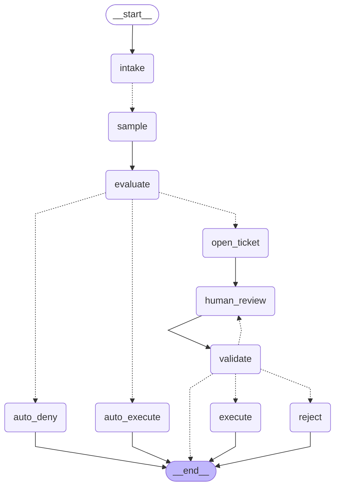
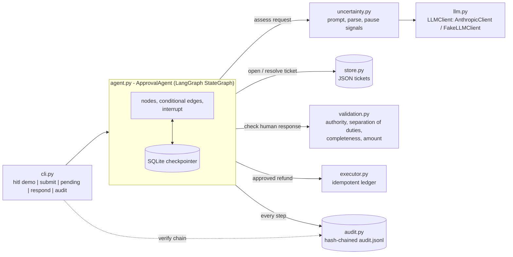

# Human-in-the-Loop Approval Agent

An LLM agent that decides on refund requests **only when it is sure**. When it is not, it pauses, asks a human a specific question, validates the answer, and resumes — with every step written to a tamper-evident audit log.

> Project 6 of my AI-engineering portfolio. **Shows: you can build safe, compliant systems.**

**Technologies:** Python 3.11+, LangGraph, langchain-anthropic (Claude), Pydantic v2, SQLite checkpointing, pytest

## Highlights

- Built as a **LangGraph `StateGraph`** with typed state, 10 explicit nodes and conditional edges; the pause is a native LangGraph `interrupt`, checkpointed to SQLite and resumed with `Command(resume=...)`.
- Six distinct uncertainty signals (low confidence, missing info, inconsistent samples, unparseable output, LLM error, high-value policy) gate every action; the agent fails closed.
- Pause/resume through durable, atomically written JSON tickets: no side effect happens while a request waits, and a pending ticket survives a process restart.
- Human input is validated before resume: authorised reviewer, separation of duties, every question answered, bounded amount edits, per-reviewer approval limits.
- SHA-256 hash-chained audit log: the offline demo writes 15 verified records across 3 requests, and tests confirm edits, deletions and reordering are detected.
- Self-consistency sampling runs as parallel graph branches (`Send` fan-out); a recursion limit caps graph steps per invocation.
- The LLM sits behind a one-method interface; the 68-test suite runs offline with a fake client and an injected clock.

## What it demonstrates

| Capability | Where | Proved by |
|---|---|---|
| **Uncertainty detection** | `uncertainty.py` | `tests/test_uncertainty.py`, `tests/test_graph.py` (parallel samples) |
| **Pause** - durable checkpoint, nothing executes while waiting; survives restarts and expires | `agent.py`, `store.py` | `test_uncertain_request_pauses...`, `test_pause_survives_process_restart`, `test_pause_is_a_langgraph_interrupt...`, `test_expired_ticket_is_not_executed` |
| **Request human input** - ticket carries the signals and the exact questions | `models.Ticket` | `test_uncertain_request_pauses...` |
| **Resume with validated context** | `validation.py` | `test_invalid_response_refused...`, `test_reviewer_approval_limit_enforced`, `test_modify_*` |
| **Full audit trail** | `audit.py` | `tests/test_audit.py` |

## Architecture

The agent is a LangGraph `StateGraph`. The diagram below is generated from the real compiled graph by `scripts/render_graph.py` (dotted edges are conditional routes); a test fails if it drifts.

<!-- flow-diagram:start -->

<!-- flow-diagram:end -->

Every node writes to `audit.jsonl` (hash chain). `human_review` is where the native `interrupt` pauses the run until a reviewer responds; `validate` can send an invalid response back to `human_review`.

How the components below connect:



Components:

- **`llm.py`** - `LLMClient` interface with `AnthropicClient` (`langchain-anthropic` `ChatAnthropic`) and `FakeLLMClient` (offline tests).
- **`uncertainty.py`** - prompts the model, parses its JSON assessment, and turns results and failures into pause signals.
- **`agent.py`** - the LangGraph `StateGraph`: typed `AgentState`, nodes, conditional edges, `interrupt`, SQLite checkpointer; `ApprovalAgent.submit/resume` wrap it.
- **`store.py`** - local-file ticket index (what a reviewer queue shows) written atomically; the graph checkpoint holds the run state.
- **`validation.py`** - authority, separation-of-duties, completeness and amount checks on human responses.
- **`executor.py`** - idempotent ledger standing in for the side-effecting payments call.
- **`audit.py`** - append-only hash-chained JSONL log with verification.
- **`cli.py`** - `hitl demo | submit | pending | respond | audit`.

## Quickstart

```bash
uv venv && uv pip install -e ".[dev]"    # or: python -m venv .venv && pip install -e ".[dev]"
pytest                                   # fully offline, no API key
hitl demo --offline                      # scripted model, no API key
cp .env.example .env                     # add ANTHROPIC_API_KEY for the real model
hitl demo                                # same scenario against Claude
```

The demo walks through: an autonomous approval; an ambiguous request that pauses; a refused human response (requester approving their own request, unanswered question, thin justification); a valid response that resumes and executes; a high-value request that policy forces to a human even though the model is confident, including a reviewer exceeding their limit and a partial (`modify`) approval; and finally verification of the audit chain.

Interactive use with real Claude:

```bash
hitl submit req-9 --requester carol --customer c9 --amount 120 --reason "arrived broken"
hitl pending
hitl respond <ticket> --reviewer bob --decision approve --justification "Photo verified" --answer "Question text=answer"
hitl audit            # prints records, exits 2 if the chain is broken
```

Configuration: `ANTHROPIC_API_KEY`, `HITL_MODEL` (default `claude-sonnet-5-5`), `HITL_DATA_DIR` (default `.hitl`).

## Design decisions and trade-offs

- **Fail closed.** Unparseable model output or an API error is itself an uncertainty signal that pauses the run; the agent never guesses. Cost: outages create human work.
- **Policy beats confidence.** Amounts at or above the limit always go to a human; the model's confidence cannot waive that.
- **Self-reported confidence is a weak signal**, so it is combined with missing-info questions, optional multi-sample consistency (`Policy.samples`), and deterministic rules. LLM confidence is not calibrated; the deterministic rules are the real guarantee.
- **Rejected responses don't consume the ticket.** A bad answer is audited and the reviewer can retry; only an accepted answer resolves it. A ticket resolves exactly once, so double-submission cannot pay twice. The executor is also idempotent per `request_id`: a repeat request reports `already_executed` (in the result, ticket and audit log) instead of paying again.
- **LangGraph where it fits, not everywhere.** Interrupts + a durable checkpointer give pause/resume for free; `Send` gives parallel sampling; conditional edges make routing explicit and testable. Graph state holds plain dicts (not Pydantic objects) so checkpoints stay portable across versions, and the `human_review` node is side-effect free because LangGraph re-runs an interrupted node on resume.
- **Two stores.** The graph checkpoint owns run state; the ticket file is the reviewer-facing index (pending list, expiry, final outcome). Cheaper than scanning checkpoints, at the cost of keeping them in step.
- **Resume does not re-ask the model.** The human's validated decision is authoritative and deterministic; answers are merged into the request context handed to the executor and recorded in the audit log.
- **Local files, no services.** Tickets are atomic JSON files, graph checkpoints a local SQLite file; the audit log is JSONL. Single-writer by design — a real deployment would swap in a database with row locks and append-only storage.
- **Tamper-*evident*, not tamper-*proof*.** The hash chain detects modification, deletion and reordering, but someone with write access can rewrite the whole chain or truncate the tail; anchoring the head hash externally would close that gap.
- **Reviewer identity is a registry in code** (`REVIEWERS` in `cli.py`); authentication is out of scope.

## Layout

```
src/hitl_agent/   package
scripts/          render_graph.py regenerates the README flow diagram
tests/            offline pytest suite (fake LLM, injected clock)
.env.example      configuration template
```
